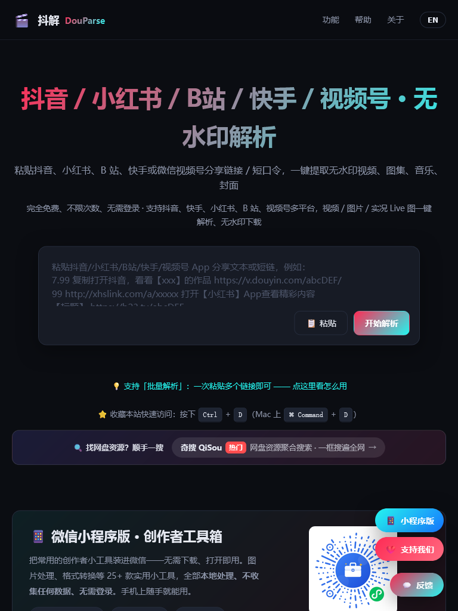

# 抖解 DouParse · 抖音/小红书/快手/B站/视频号 视频无水印解析下载工具

>  在线使用：**<https://www.qiaiwan.top>** —— 完全免费 · 无需登录 · 不限次数 · 手机电脑通用
>
> DouParse（抖解）：短视频无水印解析与下载在线工具，粘贴分享链接即可提取无水印原始视频。

粘贴各平台分享链接，一键解析并**无水印下载**原始视频、图集、背景音乐 MP3 与封面。
支持 **抖音、小红书、B站（哔哩哔哩）、快手、微信视频号、知乎、好看视频、西瓜视频、贴吧** 九大平台，
并提供**免费开放 API**（视频解析接口），适合脚本自动化与二次开发。

[🌐 在线网站](https://www.qiaiwan.top) · [🔌 开放 API 文档](https://www.qiaiwan.top/api-docs) · [🧩 浏览器扩展](https://www.qiaiwan.top/extension) · [📖 抖音无水印下载教程](https://www.qiaiwan.top/how-to-download-douyin-video)



## ✨ 功能特性

- 🎵 **抖音去水印**：抖音视频无水印下载、图集逐张/批量下载、实况 Live 图、背景音乐 MP3 提取、封面下载、文案复制
- 📕 **小红书去水印**：小红书视频/图片/图集/实况 Live 图无水印保存，xhslink 短链直接解析
- ⚡ **快手去水印**：快手短视频无水印下载，v.kuaishou.com 分享链接粘贴即解
- 📺 **B站视频下载**：b23.tv 短链 / BV 号解析，高清下载、封面提取、音频 MP3 提取
- 💬 **视频号下载**：微信视频号视频无水印解析保存
- 💡 **知乎 / 👀 好看视频 / 🍉 西瓜视频 / 🎪 贴吧**：视频无水印解析下载
- 🧰 **Pro 工具箱**：创作者批量提取、作品数据等高级功能
- 🔌 **开放 API**：一个接口解析 10+ 平台返回无水印直链，免费领 Key，缓存命中不扣次数
- 🆓 完全免费、无需登录、不装 App、网页版在线使用，不存储任何视频文件

## 🚀 使用方法（三步）

1. 在抖音 / 小红书 / 快手 / B站 / 视频号等 App 内点「分享」→「复制链接」；
2. 打开 <https://www.qiaiwan.top>，把整段分享文本粘贴进输入框；
3. 点「开始解析」，下载无水印视频 / 图集 / 音乐 / 封面。

支持批量解析：一次粘贴多个链接自动排队逐条解析。

## 📚 图文教程

| 教程 | 链接 |
|---|---|
| 抖音无水印下载教程 | <https://www.qiaiwan.top/how-to-download-douyin-video> |
| 抖音图集批量打包下载 | <https://www.qiaiwan.top/how-to-batch-download-douyin-images> |
| 抖音背景音乐提取 | <https://www.qiaiwan.top/how-to-extract-douyin-music> |
| 抖音 4K 高清下载 | <https://www.qiaiwan.top/how-to-download-douyin-hd-video> |
| iPhone / 安卓保存抖音无水印 | <https://www.qiaiwan.top/how-to-save-douyin-video-on-iphone> |
| 小红书无水印下载教程 | <https://www.qiaiwan.top/how-to-download-xiaohongshu-video> |
| 快手无水印下载教程 | <https://www.qiaiwan.top/how-to-download-kuaishou-video> |
| B站视频下载教程 | <https://www.qiaiwan.top/how-to-download-bilibili-video> |
| 视频号视频下载教程 | <https://www.qiaiwan.top/shipinhao-shipin-xiazai> |
| 在线视频去水印 | <https://www.qiaiwan.top/online-video-watermark-remover> |

更多教程与「抖音去水印 / 抖音解析 / 小红书去水印工具 / 快手去水印在线 / B站视频下载工具 /
视频去水印免费网站 / 短视频去水印工具 / 视频解析下载 / 保存到手机相册」等场景，见网站首页与帮助。

## 🔌 开放 API（开发者）

一个接口解析抖音、快手、小红书、B站、视频号等 10+ 平台，返回无水印直链：

```bash
curl -X POST "https://www.qiaiwan.top/api/v1/parse" \
  -H "Authorization: Bearer dpk_xxxxxxxx" \
  -H "Content-Type: application/json" \
  -d '{"url": "https://v.douyin.com/xxxxxx/"}'
```

免费领取 API Key、配额计费规则与错误码见 [开放 API 文档](https://www.qiaiwan.top/api-docs)。

## ❓ FAQ

- **收费吗？** 完全免费，无需注册登录。
- **会保存我的视频吗？** 不会，服务器仅临时解析转发，不落地存储。
- **支持哪些链接？** 各平台分享短链、完整链接、整段带文案的分享文本均可自动识别。
- **私密/会员内容能下载吗？** 不能，仅支持公开可见作品。

## English

**DouParse – Free online watermark remover & downloader for short videos.**
Parse share links from Douyin (TikTok China), Xiaohongshu (RED), Kuaishou, Bilibili, WeChat Channels,
Zhihu and more; download original videos, image sets, background music and covers **without watermark**.
No login, no app install, totally free. A free **open API** returns watermark-free direct links for developers.
Try it online: <https://www.qiaiwan.top>

## License

MIT © DouParse
